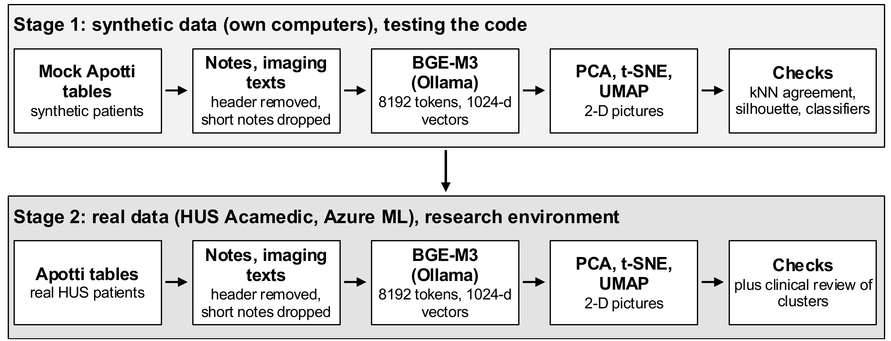

# Source or clinical content? 2-D projections of Finnish clinical text embeddings

**CMT paper ID: TODO**

AI in Health Technologies (ELEC-E8739) 2026, course project.
Alexandra Dahlberg, Heidi Tarkiainen, Joonatan Syrjänen.

## Pipeline

Stage 1: we developed and tested the code on synthetic data on our own computers. Stage 2: the same code ran on the real HUS notes inside HUS Acamedic. Only aggregate results (metrics, tables and figures) left Acamedic.

## The two notebooks

| Notebook | What it is |
| --- | --- |
| `project.ipynb` | The whole project run on the synthetic data, with the outputs of a full run kept. Runs from top to bottom. |
| `project_realdata_run.ipynb` | The same notebook run on the real notes inside HUS Acamedic. Its outputs show only aggregates (no text, counts under 3 hidden). Every number in the report comes from here. It cannot be rerun outside Acamedic. |

## How to run

1. Open `project.ipynb` in Google Colab.
2. Choose **Runtime > Run all**. The first code cell clones this repo and installs `umap-learn`.
3. The embeddings are loaded from `embeddings/`, so Ollama is not needed. A full run takes about 20 minutes on Colab on T4 GPU.

To make the embeddings again, install Ollama, run `ollama pull bge-m3` in a terminal and delete the `.npy` files in `embeddings/`.

The real-data run used the same notebook with `data_source = "real"` in Section 2. It only works inside HUS Acamedic.

## What is in the repo

| Folder or file | What it is |
| --- | --- |
| `project.ipynb` | Synthetic run, see above |
| `project_realdata_run.ipynb` | Real-data run, see above |
| `mock_data/` | Synthetic copies of the HUS Acamedic tables, same file names and columns as the real export. `mock_data/README.md` says what we planted in them |
| `embeddings/` | Saved embeddings of the synthetic notes (no text), so the notebook runs without Ollama |
| `results/` | Every figure and table the synthetic run saves |
| `figures/pipeline.png` | The pipeline figure above |

## Where each result in the report comes from

All report numbers are from `project_realdata_run.ipynb`. The same sections in `project.ipynb` give the synthetic versions, saved in `results/bge-m3/`.

| Result in the report | Notebook section | Output |
| --- | --- | --- |
| Data: 19 968 notes, 469 patients, 38 codes, 4 777 notes with a code | 3 | printed |
| Imaging texts: 2 138 reports, 2 322 requests | 3 | printed |
| Note length, 99th percentile 1 885 tokens, no note cut at 8 192 | 4 | printed |
| Fig. 1, main UMAP by note type, specialty, year and length | 5.3 | `umap.png` (see note below) |
| Fig. 2, notes vs imaging texts | 5.4 | `notes_vs_imaging.png` |
| Table 1, kNN agreement in the full space and the pictures | 6 | `knn_agreement.csv` |
| Notes vs imaging texts, kNN agreement 0.93 / 0.95 | 6 | printed |
| Silhouette scores | 6 | `silhouette.csv` |
| Classifier AUROC (linear 0.93, MLP 0.94, TF-IDF 0.89, length 0.60) | 7 | printed, `classifier_auroc.csv` |
| Physicians' notes only (0.91 vs 0.93) | 7 | printed, `classifier_auroc_doctors.csv` |
| Fig. 3, main UMAP by diagnosis code | 5.3 | `umap.png`, diagnosis code panel (see note below) |
| Fig. 4 and Spearman 0.77, picture vs classifier per ICD code | 8 | `picture_vs_classifier.png`, `per_code.csv`, printed |
| Spearman 0.88 with TF-IDF | 8 | printed (sensitivity checks) |
| Seeds, UMAP settings and row order | 9 | `seeds_and_settings.csv`, `umap_settings.png`, `umap_row_order.png`, printed |
| Note type within diagnosis groups, diagnosis within note types | 10 | `note_type_and_diagnosis_summary.csv` |
| Clinical review of the eight clusters | 11 | `clusters.png`, table in the notebook |
| Package versions | 12 | printed |

Note: Figs. 1 and 3 are `umap.png` (Section 5.3) with English labels; the data are unchanged. Figs. 2 and 4 are the notebook outputs as they are.

## Contribution statement

- **Alexandra Dahlberg:** Built the synthetic data (`mock_data/`), wrote the notebook code with Joonatan, ran the analysis on the real data in HUS Acamedic, and did the clinical review of the clusters. Contributed to the report and figures.
- **Heidi Tarkiainen:** Wrote a large part of the report, reviewed the code and contributed to the figures.
- **Joonatan Syrjänen:** Wrote the notebook code with Alexandra. Contributed to the report and figures.
- **AI tools:** Claude (Anthropic), Codex (OpenAI) for debugging code and improving the language of the report.
